# Architecture and design documentation

Vizard for Letterboxd is a SvelteKit app. The user's export zip is parsed **in the browser**; only film
titles and years go to the server, which looks them up on TMDB (plus OMDb and TheTVDB as optional
extras) and caches the answers in SQLite. All charts are computed client-side from the enriched
library.

Without an export, a viewer can enter a Letterboxd username instead. The server proxies that
member's public RSS feed (the 50 most recent diary entries) and the client builds a library from it.
The same feed tops up an export: right after an upload, and on every later visit while a snapshot is
remembered, so the zip only needs uploading once.

## 1. System overview

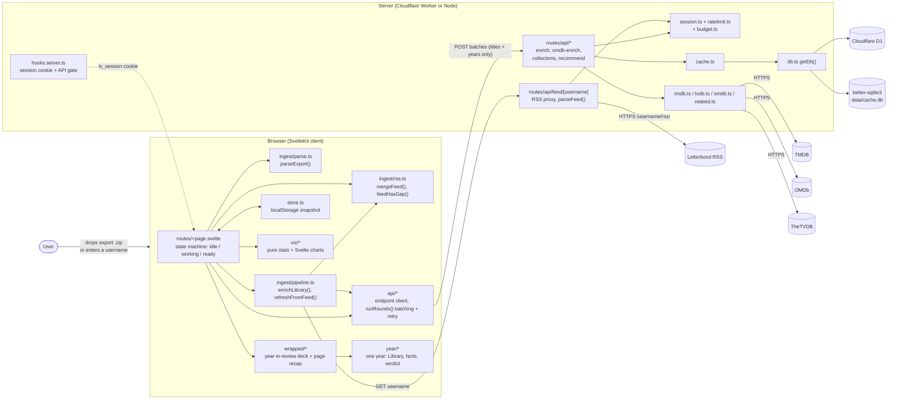

## 2. Use cases

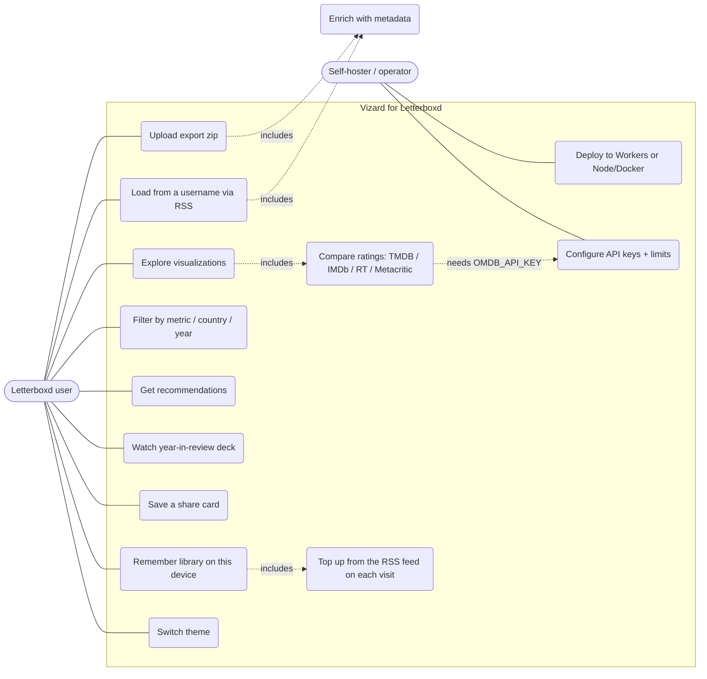

## 3. Upload and enrichment flow

The page only hands the file to the library session (`lib/library.svelte.ts`), which owns the
load, the enrichment, franchise sizes and saving. `ingest/pipeline.ts` owns all three ways a
library is loaded (`loadExport`, `loadFeed`, `refreshFromFeed`).

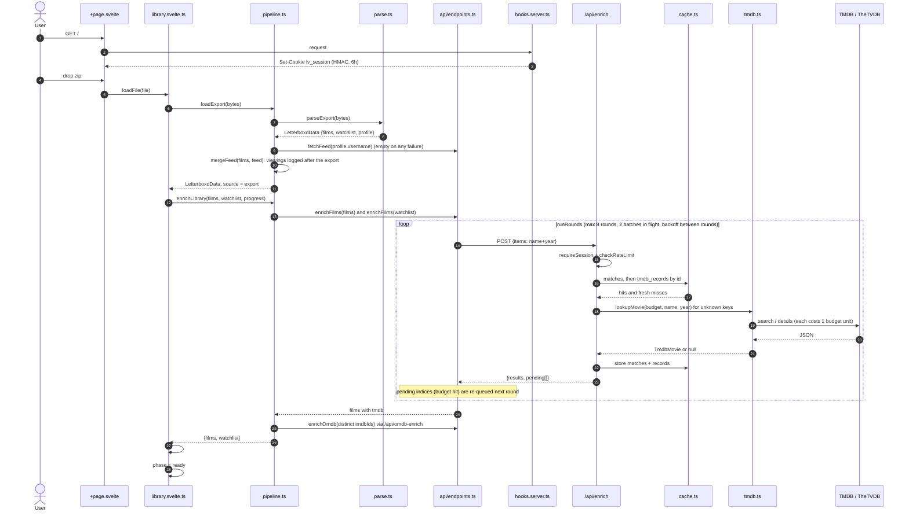

## 4. TMDB lookup strategy (`lookupMovie`, `server/enrich.ts`)

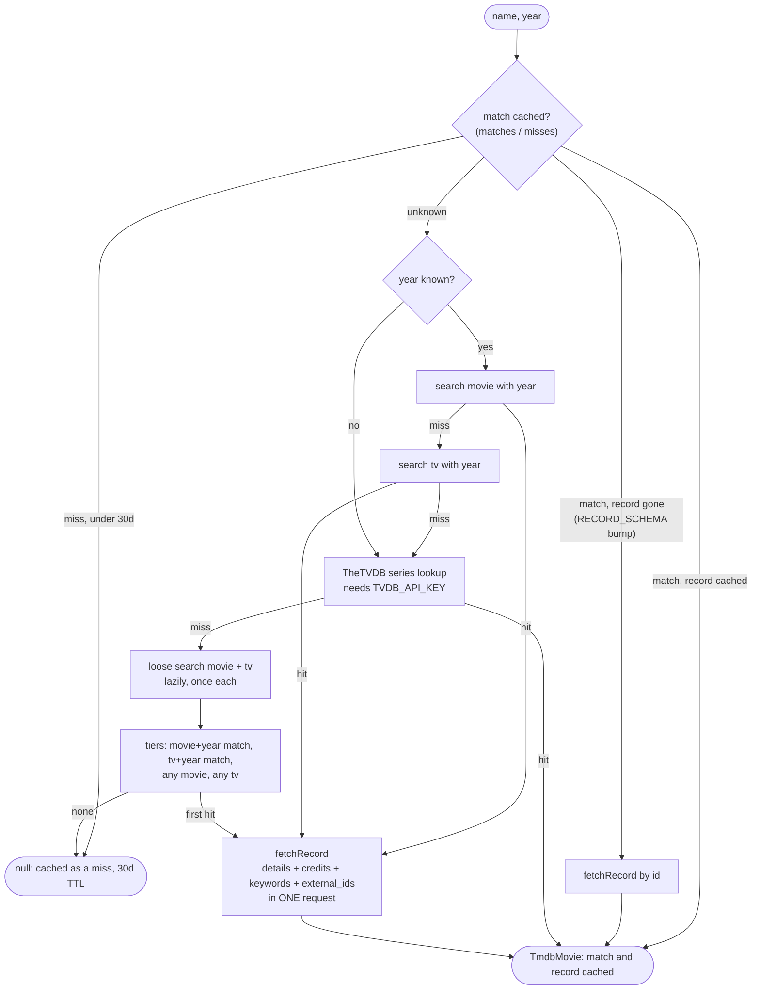

Same-titled results are told apart by year: `server/match.ts` takes the first result, in the API's
ranking, within one year of the Letterboxd year, for TMDB and TheTVDB alike. TheTVDB goes through
the same `budgetedFetch` as TMDB, so an outage there is pending, not a final miss. Its alpha-3
country codes map to alpha-2 through `virtual:alpha3-countries`, a table `vite.config.ts` builds
from the `world-countries` dev dependency at build time, so the package stays out of the Worker.
`yearOf` (in `$lib/dates`) reads the year of a TMDB date or a TheTVDB year.

## 5. Server request guards

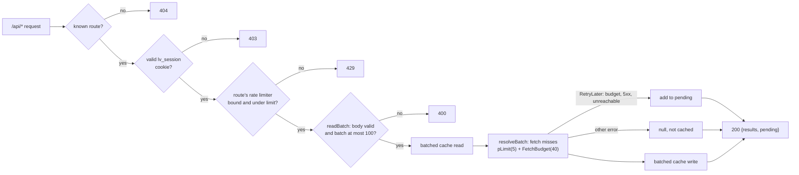

`hooks.server.ts` runs the session check and the rate limit for every known `/api` route, before
the route runs; `ratelimit.ts` holds the one table of which limiter binding each route counts
against, and a test checks it names every route. An unknown `/api` path has no route id, so it
falls through to SvelteKit's 404 ungated.

`/api/feed/[username]` validates the username (`[A-Za-z0-9_]{2,30}`, else 400). It makes one fetch
to Letterboxd, so it needs no `FetchBudget` or cache. Letterboxd's 404 passes through as 404 ("no
member called …"); any other failure becomes 502.

## 6. Server classes and modules

Every cached lookup lives in one module: its fetcher, its cache table and TTL, and the
`BatchLookup` that ties them together. The batch routes are `readBatch` plus `resolveBatch` over
that lookup; `cache.ts` and `batch.ts` know nothing about any feature.

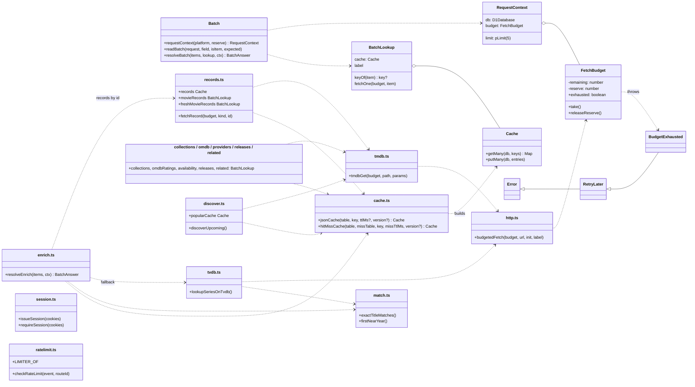

`requestContext` is built per request: Workers cap subrequests per invocation and forbid I/O
queued from another request's context. `/api/recommend` asks for one with a reserve and shares it
across its two `resolveBatch` phases; `/api/upcoming` shares its budget between the cached popular
pages and the uncached pages for the viewer's people. D1 queries are not counted in the budget:
the 10 subrequests between `FETCH_BUDGET` (default `DEFAULT_FETCH_BUDGET` = 40, in `$lib/types`) and Workers' 50 pay for them, a handful per batch
since every cache reads and writes a chunk of keys per query.

Configuration is read from `$env/dynamic/private` where it is used: `TMDB_API_KEY` in `tmdb.ts`,
`TVDB_API_KEY` in `tvdb.ts`, `OMDB_API_KEY` in `omdb.ts` (`omdbConfigured()` lets `/api/omdb-enrich`
answer all-null without one), `SESSION_SECRET` in `session.ts`, `FETCH_BUDGET` in `budget.ts` and
`CACHE_DB_PATH` in `local-db.ts`.

## 7. Data model

### Domain types (`lib/types.ts`)

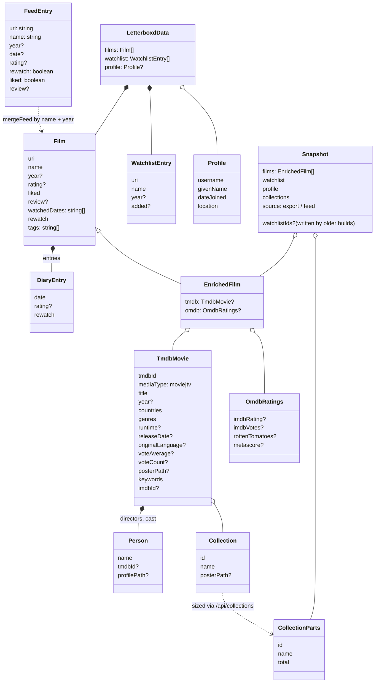

### Cache tables (`schema.sql`)

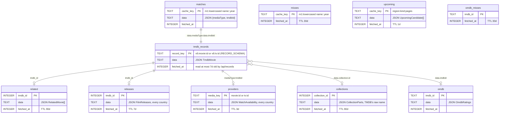

Each table is declared in code by the module whose fetcher fills it (`jsonCache` or
`hitMissCache`), and a test checks the declared tables and columns against `schema.sql`. The
self-hosted SQLite applies `schema.sql` on open; D1 needs `wrangler d1 execute --file=schema.sql`
after a table is added.

A record is stored once, by id, and versioned by `RECORD_SCHEMA` (shared with the browser
snapshot, so it only versions the record's shape). `/api/enrich` stores what a (name, year)
resolved to in `matches`, versioned on its own by `MATCH_VERSION` in `server/enrich.ts`, so a
`RECORD_SCHEMA` bump refetches records by id without searching again: `resolveEnrich` reads the
matches first and hands them to the lookup that fetches what is missing. A versioned table deletes
rows of other generations on its first read in an isolate. `/api/records` and `/api/recommend`
read the same `tmdb_records`.

## 8. Recommendations flow

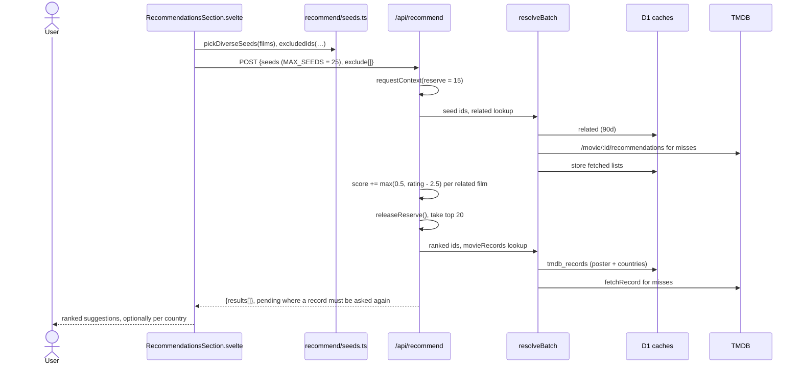

## 9. Client-side visualization layer

Charts are thin Svelte components over pure TypeScript functions that take `EnrichedFilm[]`, so the
statistics are unit-testable without a DOM. Each dashboard section in `lib/dashboard/sections/`
reads the library from context, derives its own data, holds its own toggles and renders through
one `<Section id title nav>`, which registers with a context registry; `SectionNav` lists the
registry in document order. `+page.svelte` is a list of section tags.

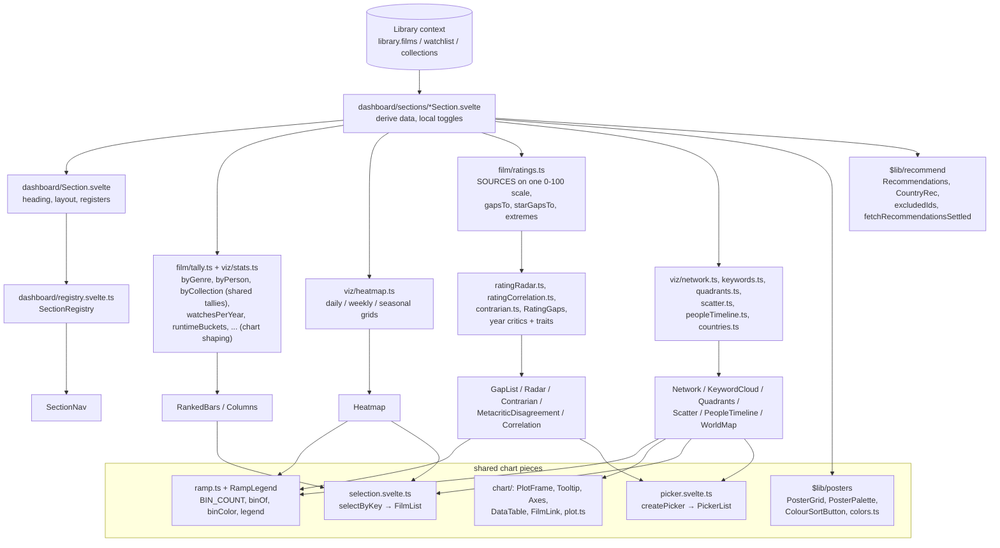

- **One rating model.** Every "you vs. a source" chart maps over `SOURCES`; a TMDB score of 0
  counts as no score everywhere.
- **One ramp.** `ramp.ts` owns how many bins there are, how a value falls into one and the legend
  text; the colours are `--map-bin-0…9` and `--degree-bin-0…9` in `app.css`, set inline through
  `binColor`.
- **Selections are keys.** A chart keeps the selected label, cell key, country code or film URI and
  looks the item up again on every read, so a feed sync never leaves a stale film list open.
- **Recommendations wait for pending films.** `/api/recommend` marks a film `pending` when its
  record did not load in time; `fetchRecommendationsSettled` re-requests those a few times for both
  the recommendation rows and a country's picks.

## 10. Year in review: the year core and its two views

`src/lib/year/` is the stable core: data in, numbers out. It imports only shared domain code
(`$lib/film`, `$lib/math`, `$lib/format`, `$lib/maps`, `$lib/types`), including the library tallies
in `$lib/film/tally` that the dashboard shares; nothing in it imports `viz/`, `wrapped/`, Svelte or
deck copy. The rule
copy in `verdict/` is the verdict's own output and lives with the rules. `src/lib/wrapped/` holds
both views of a year: the deck and the page recap card grid.

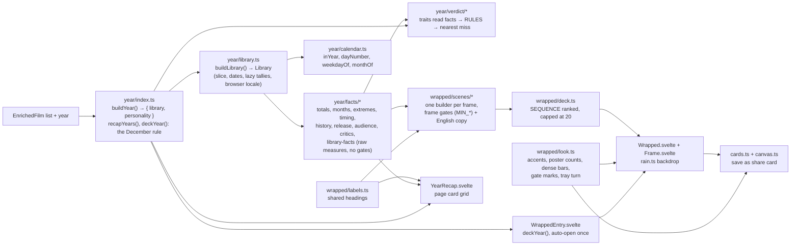

One definition per measure: `releaseYear(film)` (TMDB's year, else the export's), `votes(film)`
(TMDB + IMDb combined, used to pick and quote the deepest cut and the biggest crowd, and by The
Deep Diver), `languageName(code)` in `$lib/film/language` (languages are counted by display name
everywhere), collections grouped by TMDB id, `sittingMinutes(film)` in `$lib/film/runtime` (the longest
sitting and the mean runtime leave a series' whole-run length out), and the `OBSCURE_VOTES` / `POPULAR_VOTES` bands
that the rules and their copy both read. The obscurity spread and the Populist/Omnivore traits
keep TMDB's own vote count (`tmdbVotes`), the scale their thresholds were tuned on, with their own
`TMDB_OBSCURE_VOTES` / `TMDB_POPULAR_VOTES` bands beside the combined ones in `$lib/film/votes`.

## 11. Page state machine

The state lives in the `Library` session (`lib/library.svelte.ts`, `library.phase`), provided to
the page and every section through context.

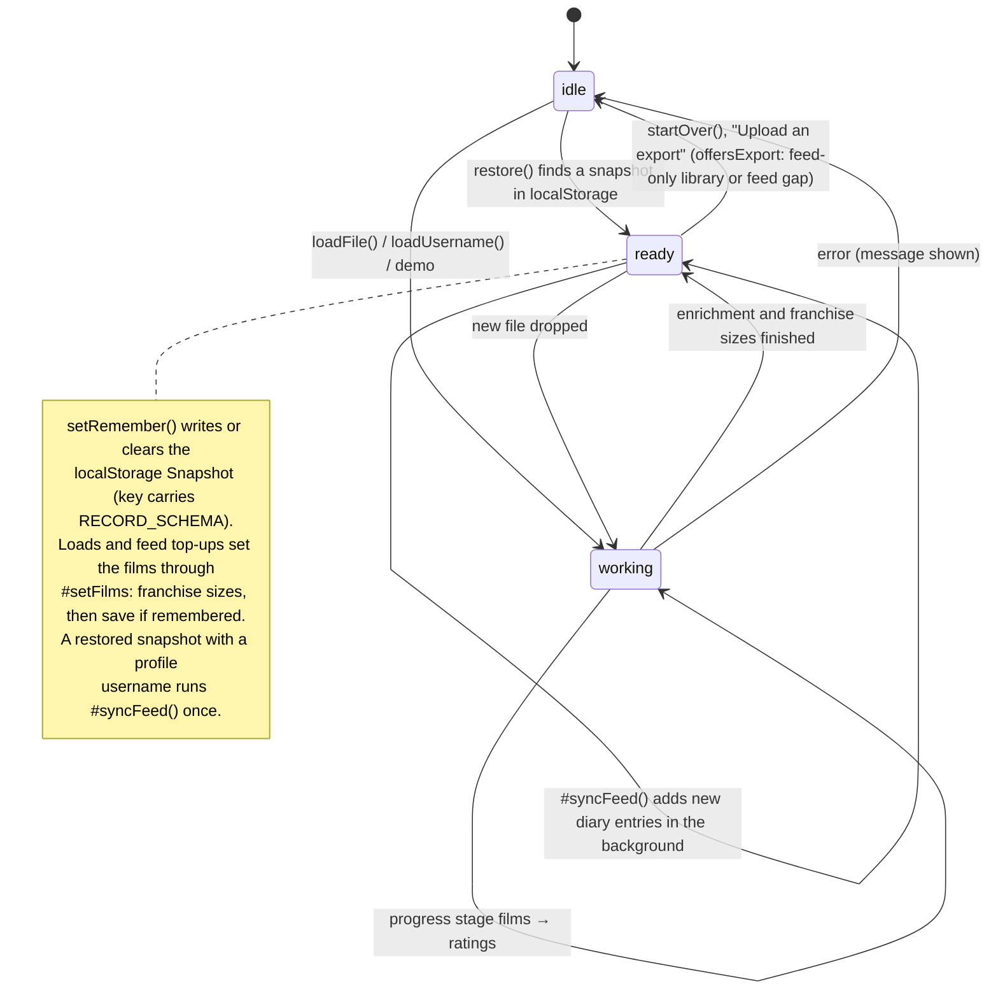

## 12. Deployment targets

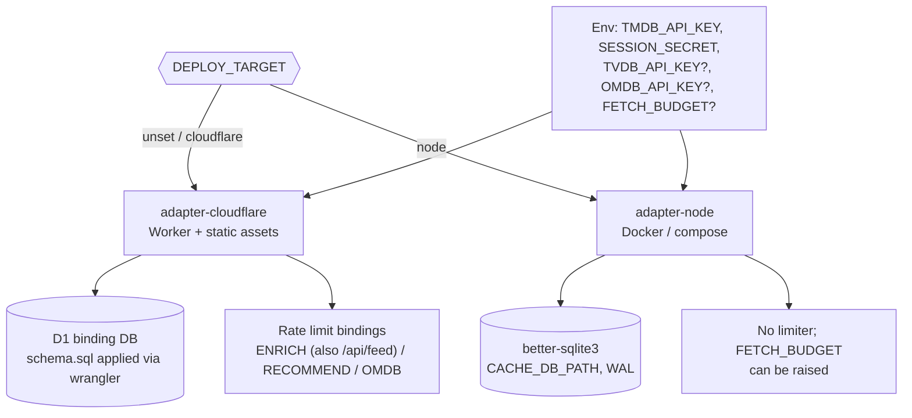

## 13. Use case catalogue

Actors: **Viewer** (a Letterboxd user, anonymous, no accounts), **Operator** (deploys and configures),
and the external systems **TMDB**, **OMDb**, **TheTVDB** and **Letterboxd RSS** which the server
calls on the viewer's behalf.

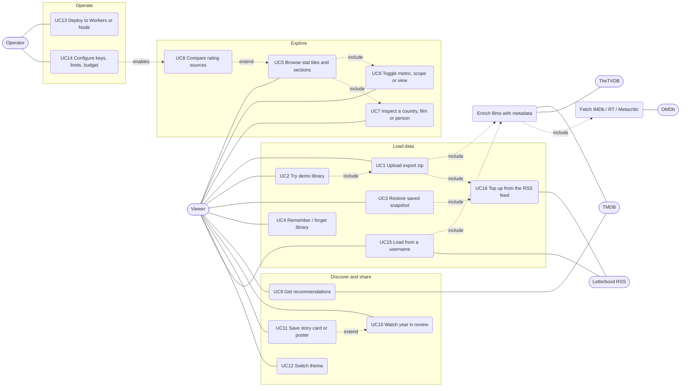

### Use case specifications

| ID   | Use case                          | Trigger                             | Main flow                                                                                                                                                                                                                                                                      | Alternatives and errors                                                                                                                                                                                                                                          |
| ---- | --------------------------------- | ----------------------------------- | ------------------------------------------------------------------------------------------------------------------------------------------------------------------------------------------------------------------------------------------------------------------------------ | ---------------------------------------------------------------------------------------------------------------------------------------------------------------------------------------------------------------------------------------------------------------- |
| UC1  | Upload export zip                 | Drop or pick a `.zip` in `FileDrop` | `parseExport` merges the CSVs, UC16 merges in newer feed entries, `enrichLibrary` resolves titles on `/api/enrich` and adds OMDb ratings, `collectionsFor` sizes franchises, page becomes `ready`                                                                              | No `watched.csv` gives "not a Letterboxd export" and the page stays `idle`. Batches that fail or hit the budget are retried for up to 8 rounds, with a short pause before each. Watchlist, OMDb and feed failures are swallowed so the main flow still completes |
| UC2  | Try demo library                  | `?demo` in dev mode                 | Fetches `/demo-export.zip` and runs UC1                                                                                                                                                                                                                                        | Dev only                                                                                                                                                                                                                                                         |
| UC3  | Restore snapshot                  | Page mount                          | `loadSnapshot` fills `films`, `watchlist`, `collections`, `profile`, `source`, page becomes `ready`, then UC16 runs in the background                                                                                                                                          | Missing, corrupt or old-generation snapshot is ignored                                                                                                                                                                                                           |
| UC4  | Remember / forget                 | `RememberToggle`                    | On: `saveSnapshot` to `localStorage`. Off: `clearSnapshot`                                                                                                                                                                                                                     | Quota exceeded: toggle reverts and an error says data lasts for this visit only                                                                                                                                                                                  |
| UC5  | Browse sections                   | Scroll or `SectionNav`              | Each `dashboard/sections/*Section.svelte` derives its chart's data from the library                                                                                                                                                                                            | Sections with no data (for example triangulation without OMDb) are hidden                                                                                                                                                                                        |
| UC6  | Toggle metric / scope             | Buttons in a chart                  | `MetricToggle`, runtime scope, season scale, keyword cloud or bars switch the derived data                                                                                                                                                                                     | none                                                                                                                                                                                                                                                             |
| UC7  | Inspect a country, film or person | Click on map, bar or node           | `selectByLabel` and chart state show a `FilmList` or detail                                                                                                                                                                                                                    | Click again clears the selection                                                                                                                                                                                                                                 |
| UC8  | Compare rating sources            | OMDb key present                    | Radar, contrarian, Metacritic gap and correlation charts                                                                                                                                                                                                                       | Without `OMDB_API_KEY` the endpoint returns all-null and the charts are hidden                                                                                                                                                                                   |
| UC9  | Get recommendations               | Section renders                     | `pickDiverseSeeds` and `pickGenreSeeds` feed `/api/recommend`, with retries `1.5s, 3.5s, 7s` while records are `pending`                                                                                                                                                       | When no seed's list can be read the answer is empty and the section shows nothing to recommend. Watchlist can be included or excluded                                                                                                                            |
| UC10 | Watch year in review              | December, or demo                   | `deckYear` then `buildYear` then `buildDeck`. Frames play on a timer or by keys. Gate frame opens the extras                                                                                                                                                                   | Years under 10 films are not eligible. The current year is held back until December                                                                                                                                                                              |
| UC11 | Save a share card                 | Share button in the deck            | `storyCard` or `summaryCard` draws to canvas, `deliver` uses the Web Share API or downloads a PNG                                                                                                                                                                              | User cancels the share sheet and nothing is saved. Canvas failure throws "picture could not be rendered"                                                                                                                                                         |
| UC12 | Switch theme                      | `ThemeSwitch`                       | Choose Catppuccin flavor and accent, stored in `localStorage`                                                                                                                                                                                                                  | Falls back to the system theme                                                                                                                                                                                                                                   |
| UC13 | Deploy                            | Build with `DEPLOY_TARGET`          | Cloudflare: Worker, assets, D1. Node: Docker with local SQLite                                                                                                                                                                                                                 | none                                                                                                                                                                                                                                                             |
| UC14 | Configure                         | `.env` / Worker vars                | `TMDB_API_KEY`, `SESSION_SECRET`, optional `TVDB_API_KEY`, `OMDB_API_KEY`, `FETCH_BUDGET`, `CACHE_DB_PATH`                                                                                                                                                                     | Missing `SESSION_SECRET` makes API routes return 500. Missing TMDB key makes lookups fail                                                                                                                                                                        |
| UC15 | Load from a username              | Submit `UsernameForm`               | `fetchFeed` calls `/api/feed/[username]`, `mergeFeed([], feed)` builds the films, profile holds only the username, `source = 'feed'`, then the UC1 enrichment steps. The page notes that only recent entries are shown and offers "Upload an export"                           | Invalid name: 400. Unknown member: 404. Letterboxd unreachable or refusing: 502. A feed with no film items gives "no diary entries". No watchlist, tags or undated watches                                                                                       |
| UC16 | Top up from the RSS feed          | After UC1 parsing, or after UC3     | `fetchFeed(profile.username)`, then `mergeFeed` adds viewings not yet on record. On UC3, `refreshFromFeed` enriches only the films the feed introduced, `collectionsFor` sizes new franchises, and the snapshot is saved again. A status line says how many entries were added | A full feed (50 film items) that starts after the newest saved viewing sets `feedGap` and asks for a fresh export. A failed request leaves the library as it was, with a short note on UC3                                                                       |

## 14. Class diagram: client ingest, state and persistence

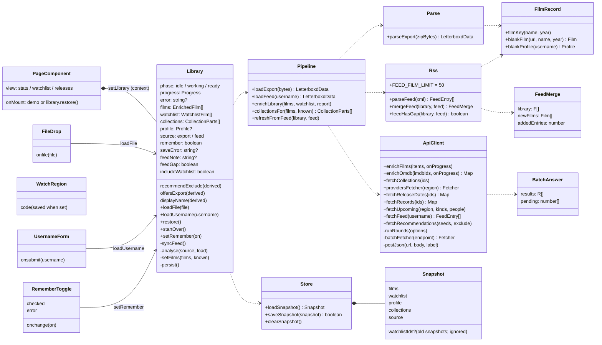

`WatchRegion` (`region/region.svelte.ts`) is the one country preference the watchlist and the
release calendar share; `RegionSelect` sets it and it saves itself. The watchlist reloads its saved
services whenever the region changes, from either view.

## 15. Class diagram: visualization data structures

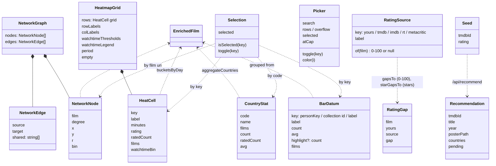

## 16. Class diagram: year core, deck, verdicts and share cards

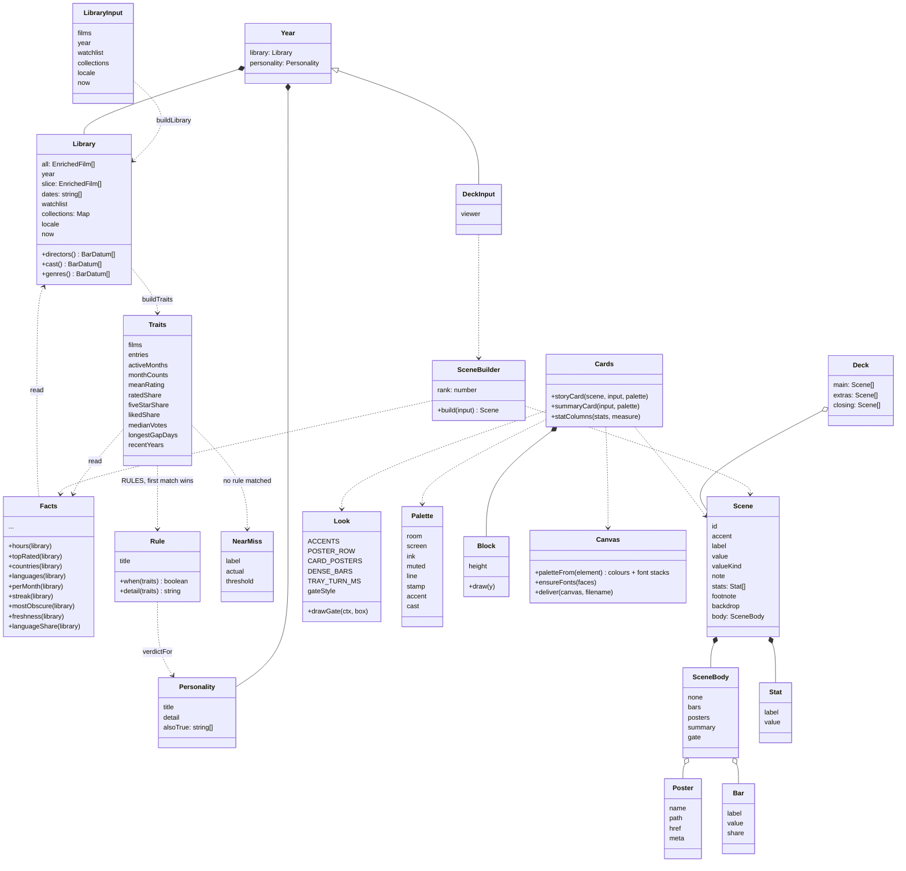

## 17. Svelte component hierarchy

```mermaid
flowchart TD
    layout["+layout.svelte<br/>global css, theme"] --> page["+page.svelte<br/>sets Library + SectionRegistry contexts"]

    page --> FileDrop
    page --> UsernameForm
    page --> RememberToggle
    page --> ThemeSwitch
    page --> SectionNav
    page --> SummaryTiles --> StatTiles
    page --> WrappedEntry
    page --> Unmatched

    subgraph sections["dashboard/sections (each renders one Section)"]
        WorldSection --> WorldMap --> CountryRec
        RatingsSection --> Columns & RatingGaps
        CriticsSection --> RatingRadar & RatingContrarian & MetacriticDisagreement & RatingCorrelation
        WhenSection --> Heatmap
        LengthSection --> Scatter
        QuadrantsSection --> Quadrants
        ThemesSection --> KeywordCloud
        PeopleTimelineSection --> PeopleTimeline
        NetworkSection --> Network
        MosaicSection --> Mosaic
        MilestonesSection --> Milestones
        RecapSection --> YearRecap
        others["Recent, Years, Lag, Runtime, Rewatches,<br/>Genres, Franchises, Obscurity, People"] --> RankedBars
    end
    page --> sections
    page --> Recommendations

    subgraph kit["viz/chart + shared"]
        PlotFrame
        Tooltip
        Axes
        DataTable
        FilmLink
        RampLegend
        PickerList
        FilmList
        GapList
        PosterGrid
        ColourSortButton
    end
    Scatter & Quadrants & PeopleTimeline --> PlotFrame
    PlotFrame & WorldMap & Network & RatingRadar --> Tooltip
    Heatmap & WorldMap & Network & RatingCorrelation --> RampLegend
    RatingRadar & PeopleTimeline --> PickerList
    Mosaic --> PosterGrid & ColourSortButton

    page --> Watchlist --> PosterWall --> PosterGrid
    page --> ReleaseCalendar --> KindPicker & CalendarMonth & RecommendControls

    WrappedEntry --> Wrapped["Wrapped.svelte<br/>dialog, timer, keyboard"]
    Wrapped --> Frame["Frame.svelte<br/>renders one Scene"]
    Wrapped --> rain["rain.ts backdrop"]
    Wrapped --> cards["cards.ts share card"]
```

YearRecap renders its own `<section id="recap">`; RecapSection lists that element in the registry
instead of wrapping it in a second section.

## 18. Activity: parsing and merging the export

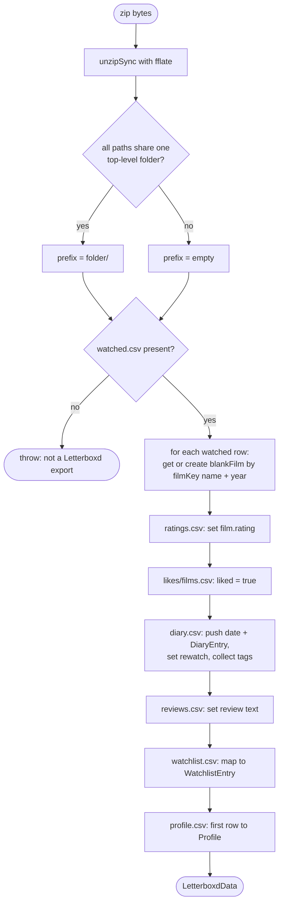

## 19. Activity: how a verdict is chosen

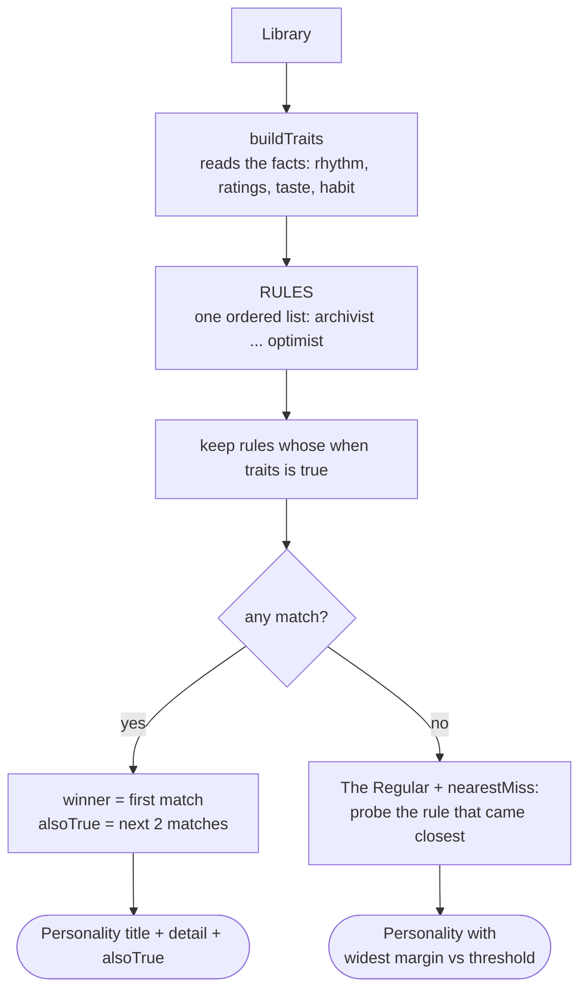

## 20. Activity: building the deck

```mermaid
flowchart TD
    y["deckYear(films, now)<br/>December, or ?demo in dev"] --> by["buildYear → Year<br/>null under ten films"]
    by --> w["DeckInput = Year + viewer"]
    w --> s[SEQUENCE of 36 scene builders<br/>in narrative order, each with a rank]
    s --> b[run every builder: call its facts,<br/>apply its own MIN_* gate]
    b --> nn[drop builders that returned null<br/>not enough data for that frame]
    nn --> sort[sort by rank, keep top DECK_CAP = 20 ids]
    sort --> main[main: kept scenes in narrative order]
    sort --> extras[extras: scenes the cap pushed out]
    w --> close[closing: verdictScene + summaryScene]
    main --> asm[assemble deck, expanded?]
    extras --> asm
    close --> asm
    asm --> g{extras exist?}
    g -- yes --> gate[insert gate frame after main<br/>expanded: also append extras]
    g -- no --> out
    gate --> out([Scene list shown by Wrapped.svelte])
```

## 21. Sequence: share card

```mermaid
sequenceDiagram
    actor U as User
    participant W as Wrapped.svelte
    participant K as cards.ts
    participant V as canvas.ts
    participant N as Browser share / download

    U->>W: click Share
    W->>V: paletteFrom(element): colours and --font-* stacks
    alt last frame
        W->>K: summaryCard(input, palette)
    else any other frame
        W->>K: storyCard(scene, input, palette)
    end
    K->>V: ensureFonts(palette.faces)
    K->>K: measure blocks, centre stack, draw on the card canvas
    K->>K: drawGate: the same dust, hair and lens falloff as the slide (look.ts)
    K->>V: loadImage(poster urls)
    K-->>W: HTMLCanvasElement
    W->>V: deliver(canvas, filename)
    V->>V: toBlob image/png
    alt navigator.canShare with files
        V->>N: navigator.share
        N-->>V: shared or AbortError (cancelled)
    else fallback
        V->>N: anchor download, revoke URL after 1s
        N-->>V: saved
    end
```

## 22. Sequence: session cookie and API protection

```mermaid
sequenceDiagram
    participant B as Browser
    participant H as hooks.server.ts
    participant S as session.ts
    participant L as ratelimit.ts
    participant A as /api route

    B->>H: GET / (page load)
    H->>S: issueSession(cookies)
    alt SESSION_SECRET set and cookie missing, expired or badly signed
        S-->>B: Set-Cookie lv_session (expiry.hmacSha256) httpOnly, sameSite lax, 6h
    end
    B->>H: POST /api/enrich + cookie
    H->>S: requireSession(cookies)
    alt SESSION_SECRET not set
        S-->>B: 500
    else cookie invalid
        S-->>B: 403 reload the page
    else ok
        H->>L: checkRateLimit(event, route id)
        alt limiter bound and over its limit
            L-->>B: 429
        else
            H->>A: resolve: validation, lookup
        end
    end
```

## 23. Sequence: client retry loop against the fetch budget

```mermaid
sequenceDiagram
    participant R as runRounds
    participant W1 as worker 1
    participant W2 as worker 2
    participant API as /api batch endpoint

    Note over R: round 0: 50 for enrich, 35 for one-fetch-per-item endpoints (sized from DEFAULT_FETCH_BUDGET)
    R->>W1: batch A
    R->>W2: batch B
    par
        W1->>API: POST A
        API-->>W1: results + pending [3, 7]
    and
        W2->>API: POST B
        API-->>W2: network error
    end
    W1->>R: keep resolved, queue pending 3 and 7
    W2->>R: queue the whole batch B
    Note over R: round 1..7 use batches of 15 for the leftovers
    loop until queue empty or 8 rounds
        R->>API: POST retry batches
        API-->>R: results + pending
    end
    Note over R: anything still unresolved stays null (shown as unmatched)
```

## 24. Sequence: RSS feed, from a username and on a return visit

Letterboxd's official API is closed to visualization projects, and its HTML pages sit behind a
Cloudflare bot check that answers plain HTTP clients with 403. The profile RSS feed is the one
public, machine-readable source. It holds the 50 newest film items (diary entries and reviews,
with watch date, rating, rewatch, like, review text and TMDB id) plus up to 50 list items, which
are skipped. It cannot be paged back.

```mermaid
sequenceDiagram
    autonumber
    actor U as User
    participant P as library.svelte.ts
    participant PI as pipeline.ts
    participant AP as api/endpoints.ts
    participant F as /api/feed
    participant L as letterboxd.com
    participant S as store.ts

    alt username entered (UC15)
        U->>P: loadUsername(username)
        P->>PI: loadFeed(username)
        PI->>AP: fetchFeed(username)
        AP->>F: GET + lv_session cookie
        F->>L: GET /username/rss/
        L-->>F: RSS XML
        F->>F: parseFeed(xml)
        F-->>AP: {entries: FeedEntry[]}
        PI->>PI: mergeFeed([], feed).newFilms, blankProfile(username)
        PI-->>P: LetterboxdData, source = feed
        P->>PI: enrichLibrary, then #setFilms (as in section 3)
    else snapshot restored (UC3, then UC16)
        P->>S: restore(): loadSnapshot()
        S-->>P: films, profile.username, source
        P->>P: phase = ready (charts render at once)
        P->>AP: fetchFeed(profile.username)
        AP->>F: GET
        F-->>AP: FeedEntry[]
        P->>PI: refreshFromFeed(films, feed)
        PI->>PI: feedHasGap, mergeFeed
        PI->>PI: enrichLibrary(newFilms only)
        PI-->>P: {films: library + new, addedEntries, gap}
        opt addedEntries > 0
            P->>P: #setFilms: collectionsFor(films, collections)
            P->>S: saveSnapshot() if remembered
        end
    end
```

## 25. Activity: merging a feed into a library

```mermaid
flowchart TD
    A([library films, feed entries newest first]) --> G{"feed full (50 film items) and<br/>oldest feed date after<br/>newest saved viewing?"}
    G -- yes --> GAP[gap = true:<br/>ask for a fresh export]
    G -- no --> M
    GAP --> M[copy every film,<br/>key by filmKey name + year]
    M --> R[walk feed oldest first]
    R --> K{film with this<br/>name + year known?}
    K -- no --> N[blankFilm with canonical<br/>/film/slug/ uri, kept apart as new]
    K -- yes --> E
    N --> E[liked = true if memberLike,<br/>review text if a review item]
    E --> RT{entry date at or after<br/>film's latest viewing?}
    RT -- yes --> SR[film.rating = entry rating]
    RT -- no --> D
    SR --> D{date missing or<br/>already on record?}
    D -- yes --> NEXT
    D -- no --> P[push date + DiaryEntry,<br/>set rewatch, addedEntries++]
    P --> NEXT{more entries?}
    NEXT -- yes --> R
    NEXT -- no --> OUT([FeedMerge: library, newFilms, addedEntries])
```

The feed never removes anything. Ratings changed or entries deleted on Letterboxd after the export
stay as the export had them, and watches without a diary date, tags and the watchlist only ever
come from an export.

## How it works, in short

1. **Parse locally.** `parseExport` unzips with `fflate`, reads CSVs with PapaParse, and merges
   `watched`, `ratings`, `likes/films`, `diary`, `reviews` into one `Film` per name+year.
2. **Enrich in batches.** The client sends only `{name, year}` to `/api/enrich`. The server answers
   what it can from cache and fetches the rest from TMDB under a per-request `FetchBudget`
   (Workers' 50-subrequest limit). Anything cut off is returned in `pending` and the client's
   `runRounds` re-queues it, so large libraries still finish in one visit.
3. **Cache once, share across users.** A (name, year) match lives in `matches`, a known miss in
   `misses` (30-day TTL), and each record once by id in `tmdb_records`. Record keys carry the
   `RECORD_SCHEMA` generation from `types.ts`, as does the browser snapshot key; old generations
   are swept on first read.
4. **Add ratings and franchises.** IMDb ids from TMDB drive `/api/omdb-enrich`; collection ids drive
   `/api/collections` so "five of six" can be said.
5. **Visualize.** `+page.svelte` derives every chart's data from `EnrichedFilm[]` with pure
   functions in `lib/viz`, and feeds the same list into the Wrapped deck.
6. **Remember (opt-in).** A `Snapshot` in `localStorage` lets repeat visits skip the upload.
7. **Keep current through RSS.** `/api/feed/[username]` proxies the member's public feed.
   `mergeFeed` folds its 50 newest entries into the library after an upload and on each return
   visit, and a username alone is enough to build a small library. `feedHasGap` asks for a fresh
   export when the feed no longer overlaps what was saved.
8. **Abuse guard.** `hooks.server.ts` issues an HMAC-signed session cookie on page loads and
   requires it on every API route, plus an optional Cloudflare rate limiter per route.
